<p align="center">
  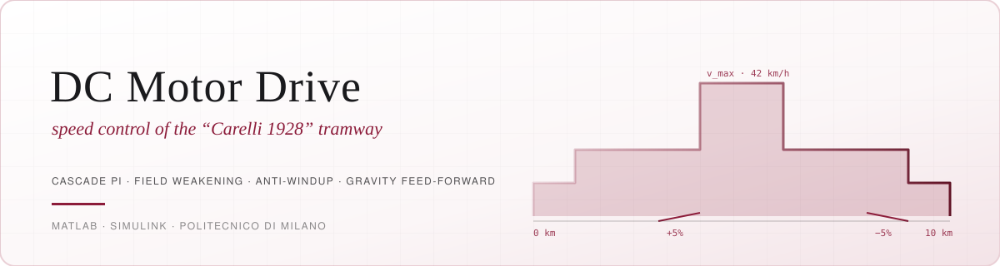
</p>

<p align="center">
  
  
  
  
  
</p>

<p align="center"><i>
Four series-excitation DC motors, one 25.4-tonne tram, ten kilometres of track,<br>
and three PI loops that have to agree with each other the whole way.
</i></p>

---

## ✦ Contents

- [The problem](#-the-problem)
- [From four motors to one equivalent machine](#-from-four-motors-to-one-equivalent-machine)
- [Plant model](#-plant-model)
- [Control architecture](#-control-architecture)
- [Tuning](#-tuning)
- [Results](#-results)
- [Repository layout & how to run](#-repository-layout--how-to-run)

---

## ✦ The problem

The *Carelli 1928* tramway is driven by **four series-excitation DC motors**. The goal is to make the tram follow a
position-dependent speed profile along a **10 km** track, accelerating, braking and holding speed on **±5 %** slopes,
without ever asking the machine for more than its rated **156 A** armature current or the **600 V** line.

| Position [km] | 0–1 | 1–3 | 3–4 | 4–6 | 6–8 | 8–9 | 9–10 |
|:--|:--:|:--:|:--:|:--:|:--:|:--:|:--:|
| **Slope** | 0 | 0 | **+5 %** | 0 | 0 | **−5 %** | 0 |
| **Speed ref.** | v<sub>r</sub>/2 | v<sub>r</sub> | v<sub>r</sub> | **v<sub>max</sub>** | v<sub>r</sub> | v<sub>r</sub> | v<sub>r</sub>/2 |

The 4–6 km section is where it gets interesting: v<sub>max</sub> = 42 km/h is above the base speed of the motor, so the drive
has to leave the constant-torque region and enter **field weakening**.

<details>
<summary><b>Motor & vehicle data</b> (click to expand)</summary>

| Parameter | Symbol | Value |
|:--|:--:|--:|
| Line voltage | V<sub>DC</sub> | 600 V |
| Rated power (each motor) | P<sub>n</sub> | 21 kW |
| Overall rated current | I<sub>tot,n</sub> | 156 A |
| Machine constant | K | 1.06 N·m/A |
| Armature resistance / time constant | R<sub>a</sub>, τ<sub>a</sub> | 0.39 Ω, 10 ms |
| Excitation rated voltage / current | V<sub>e,n</sub>, I<sub>e,n</sub> | 60 V, 5 A |
| Excitation resistance / time constant | R<sub>e</sub>, τ<sub>e</sub> | 12 Ω, 0.1 s |
| Rated motor speed | Ω<sub>n</sub> = Ω<sub>b</sub> | 970 rpm |
| Max vehicle speed | v<sub>max</sub> | 42 km/h |
| Vehicle mass (empty) + load | m<sub>T</sub> | 15 t + 130 × 80 kg |
| Wheel diameter | d | 680 mm |
| Gearbox ratio (motor → wheels) | ρ | 13/74 |
| Friction coefficient | β | 0.81 N·m·s |

</details>

---

## ✦ From four motors to one equivalent machine

Following the assignment, the four series-excitation motors are lumped into **one equivalent separately-excited DC machine**,
with K<sub>S</sub> ≈ K<sub>T</sub> ≜ K = 1.06 N·m/A. Derived quantities:

| Quantity | Expression | Value |
|:--|:--|--:|
| Armature inductance | L<sub>a</sub> = R<sub>a</sub> τ<sub>a</sub> | 3.9 mH |
| Excitation inductance | L<sub>e</sub> = R<sub>e</sub> τ<sub>e</sub> | 1.2 H |
| Total mass (fully loaded) | m = m<sub>T</sub> + 130·80 | 25 400 kg |
| Equivalent inertia at the shaft | J<sub>eq</sub> = m ρ² d² / 4 | **90.62 kg·m²** |
| Base speed | Ω<sub>b</sub> = 970 · 2π/60 | 101.58 rad/s |
| Rated linear speed | v<sub>r</sub> = Ω<sub>b</sub> ρ d/2 | 6.07 m/s ≈ 21.9 km/h |
| Nominal torque | T<sub>n</sub> = K I<sub>e,n</sub> I<sub>tot,n</sub> | 826.8 N·m |
| Nominal back-EMF | E<sub>n</sub> = V<sub>DC</sub> − R<sub>a</sub> I<sub>tot,n</sub> | 539.16 V |

> [!NOTE]
> **Two independent sanity checks** confirm that the data describe the four-motor set as a whole:
> - T<sub>n</sub> = K I<sub>e,n</sub> I<sub>tot,n</sub> ≈ 826.8 N·m ≈ 4 · 21 kW / 101.58 rad/s ≈ 827 N·m
> - E<sub>n</sub> from the circuit (539.16 V) ≈ E<sub>n</sub> = K I<sub>e,n</sub> Ω<sub>b</sub> from the machine constant (538.4 V)

---

## ✦ Plant model

The machine is described by two electrical equations and one mechanical equation:

$$
v_a = L_a\frac{di_a}{dt} + R_a i_a + K\,i_e\,\Omega ,\qquad
v_e = L_e\frac{di_e}{dt} + R_e i_e ,\qquad
K\,i_e\,i_a - T_r = J_{eq}\frac{d\Omega}{dt} + \beta\,\Omega
$$

so the three sub-plants used for design are

$$
G_a(s)=\frac{1}{R_a+sL_a},\qquad G_e(s)=\frac{1}{R_e+sL_e},\qquad G_\Omega(s)=\frac{K}{J_{eq}s+\beta}.
$$

β is deliberately kept in $G_\Omega$: it is a real pole of the system, not something to idealise into a pure integrator.

**Gravity.** Applying Newton's second law to a wheel rolling without slip on a slope of θ (slope % = 100 tan θ) and reflecting
it to the motor shaft gives the load torque

$$
T_r = m\,g\,R\,\rho\,\sin\!\Big(\arctan\frac{\text{slope}}{100}\Big),\qquad R=\frac d2 .
$$

<p align="center">
  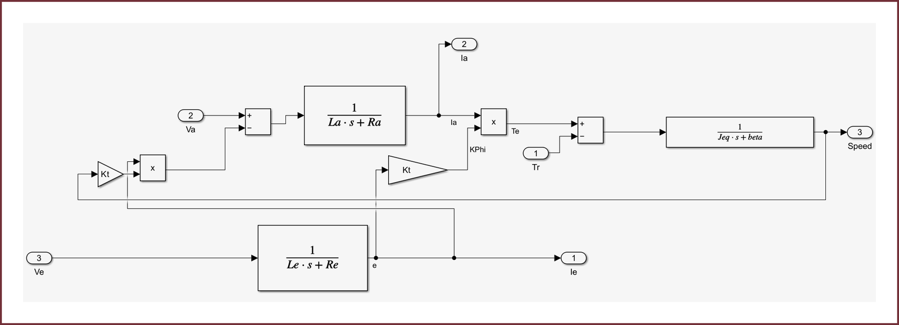<br>
  <sub><b>Fig. 1</b> — Simulink subsystem of the equivalent DC machine.</sub>
</p>

---

## ✦ Control architecture

<p align="center">
  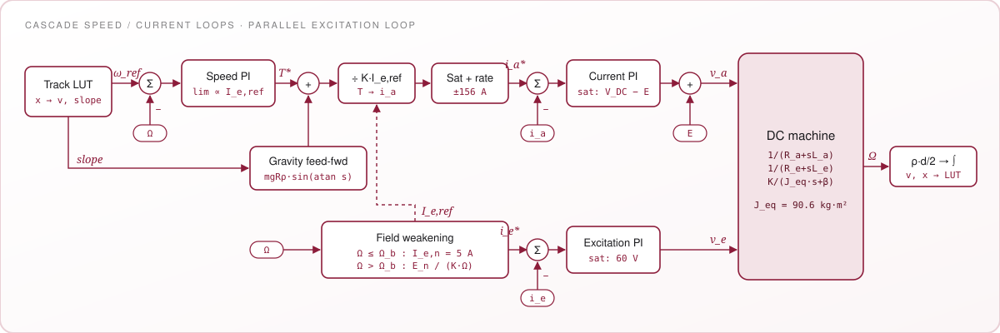
</p>

Three PI regulators: **speed → armature current** in cascade, and an **excitation** loop running in parallel.
What makes the scheme behave well is not the PIs themselves but the details around them:

| Design choice | Why it is there |
|:--|:--|
| **Variable torque limit** ±K·I<sub>e,ref</sub>·I<sub>a,max</sub> on the speed PI | T<sub>max</sub> depends on flux. In field weakening the available torque shrinks, so a fixed limit would request currents above 156 A. |
| **i<sub>a,ref</sub> = T<sub>ref</sub> / (K·I<sub>e,ref</sub>)** using the *reference*, not the measured i<sub>e</sub> | Avoids dividing by ≈ 0 at start-up while the slow (τ<sub>e</sub> = 0.1 s) field builds up, and stays consistent with the torque limit. |
| **Rate limiter** on i<sub>a,ref</sub> | Stops the current loop from overshooting on reference steps. |
| **Back-EMF compensation + saturation at V<sub>DC</sub> − E** | The PI only supplies the residual voltage, so v<sub>a</sub> never exceeds the 600 V line. |
| **Field weakening** I<sub>e,ref</sub> = E<sub>n</sub>/(K·Ω) for Ω > Ω<sub>b</sub> | Keeps E = E<sub>n</sub> above base speed; continuous at Ω<sub>b</sub> since E<sub>n</sub>/(KΩ<sub>b</sub>) ≈ 5 A. |
| **Gravity feed-forward** added to T<sub>ref</sub> | The controller anticipates the slope instead of reacting after the speed has already dropped. |
| **Back-calculation anti-windup** on all three PIs, K<sub>b</sub> = K<sub>i</sub>/K<sub>p</sub> | Torque and voltages saturate often; without it the integrators wind up and overshoot. |

<details>
<summary><b>Controller sub-systems in Simulink</b> (click to expand)</summary>
<br>
<p align="center">
  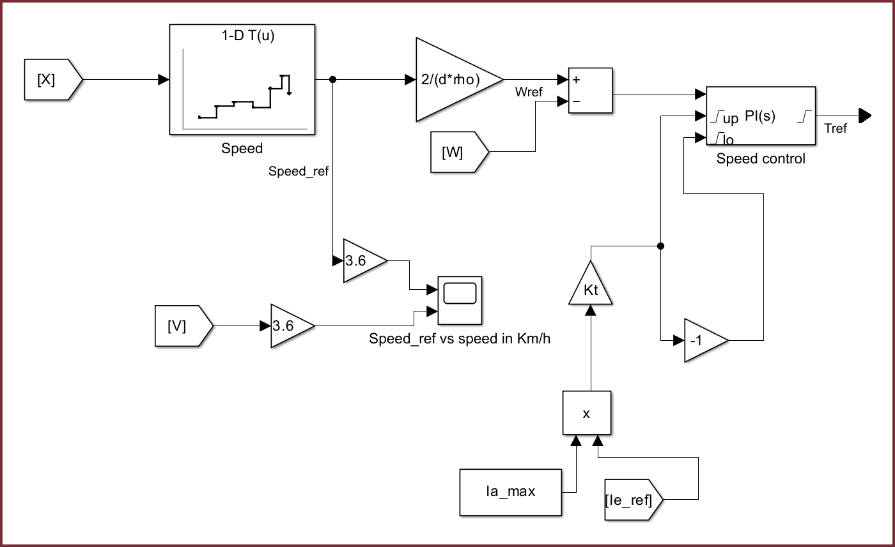<br>
  <sub><b>Fig. 2</b> — Speed controller: reference LUT, conversion to ω, PI with variable torque limits.</sub>
</p>
<p align="center">
  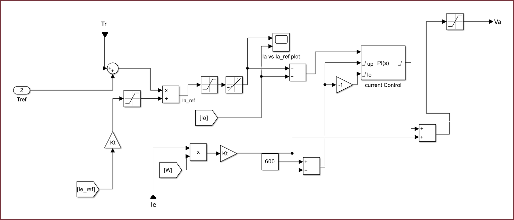<br>
  <sub><b>Fig. 3</b> — Armature current controller: T → i conversion, saturation, rate limiter, PI with voltage-dependent limits and back-EMF compensation.</sub>
</p>
<p align="center">
  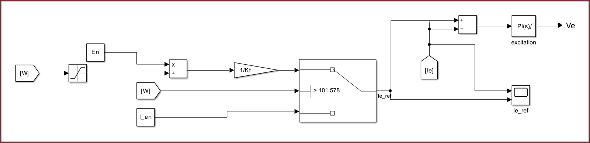<br>
  <sub><b>Fig. 4</b> — Excitation controller: field-weakening logic driven by rotor speed.</sub>
</p>
<p align="center">
  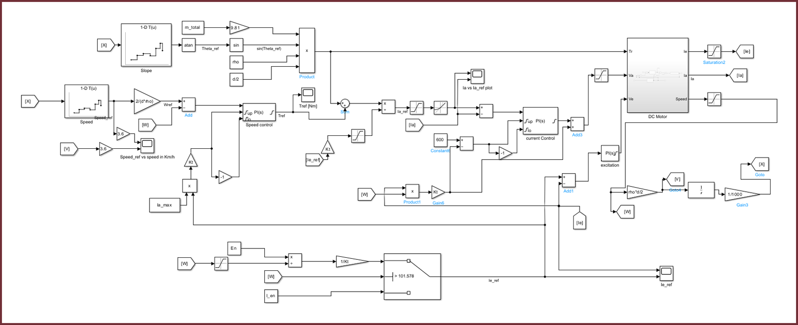<br>
  <sub><b>Fig. 5</b> — The complete Simulink model.</sub>
</p>
</details>

---

## ✦ Tuning

All loops were tuned with `pidtune` on the first-order plants above. Bandwidths are separated by roughly a decade so
the loops can be treated as decoupled, and the back-EMF can be neglected when designing the current loop.

| Loop | ω<sub>c</sub> [rad/s] | Phase margin | K<sub>p</sub> | K<sub>i</sub> |
|:--|:--:|:--:|--:|--:|
| Armature current | 100 | 85° | 0.3545 | 42.25 |
| Excitation current | 10 | 60° | 4.39 | 163.92 |
| Angular speed | 0.5 | 65° | 38.42 | 9.38 |

> [!TIP]
> **Why only 0.5 rad/s on the speed loop?** It comes from the physics of the tram. With J<sub>eq</sub> = 90.6 kg·m²
> and T ≤ T<sub>n</sub> ≈ 827 N·m, the shaft can accelerate at most ≈ 9 rad/s², about 0.55 m/s² at the rail.
> Speed transients are set by the actuator limit, not by the controller. A larger bandwidth would push the PI further
> into saturation at every step without making the response any faster, and would make the loop more sensitive.

---

## ✦ Results

Simulation over the full 10 km track (≈ 2000 s). <b>Red</b> = reference, <b>blue</b> = measured.

<table>
<tr>
<td width="50%" align="center">
  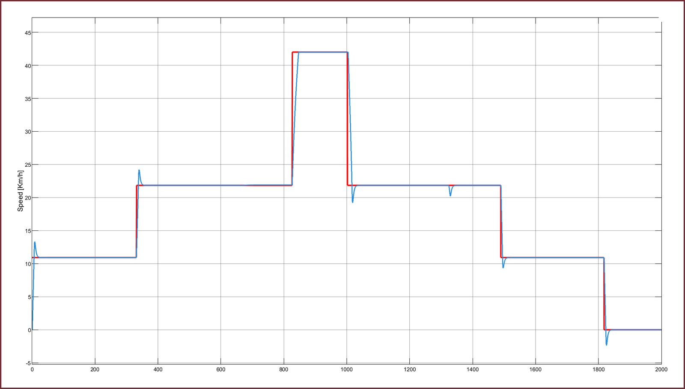<br>
  <sub><b>Speed [km/h].</b> Tracks the reference with no steady-state error. The sloped edges come from the torque limit
  and the large inertia. Feed-forward keeps the dips at the slope changes small.</sub>
</td>
<td width="50%" align="center">
  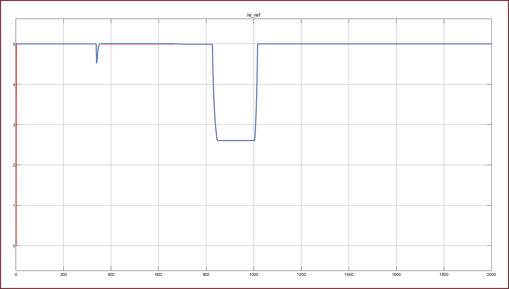<br>
  <sub><b>Excitation current [A].</b> Stays at 5 A, drops to ≈ 2.6 A only in the 4–6 km field-weakening section.
  No overshoot.</sub>
</td>
</tr>
<tr>
<td width="50%" align="center">
  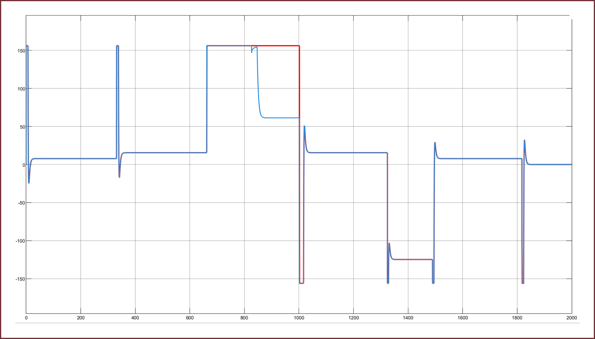<br>
  <sub><b>Armature current [A].</b> Peaks at every speed change are clamped at ±156 A. The plateaus are the torque
  needed to hold speed, including the slopes.</sub>
</td>
<td width="50%" align="center">
  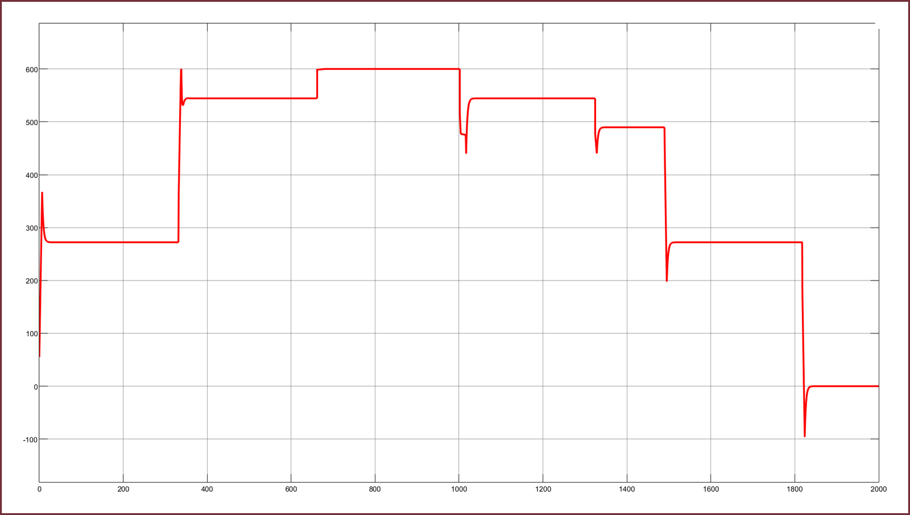<br>
  <sub><b>Armature voltage [V].</b> Clamped at V<sub>DC</sub> = 600 V throughout the v<sub>max</sub> section.
  This is the voltage limit of the constant-power region.</sub>
</td>
</tr>
</table>

### Reading the field-weakening section correctly

Between 4 and 6 km the current reference stays saturated at 156 A while the measured current settles around **60 A**.
This is the expected behaviour at the voltage limit, not a fault in the current loop:

$$
v_a - E \;\approx\; 600\,\text{V} - 539\,\text{V} \;\approx\; 60\,\text{V}
\quad\Longrightarrow\quad
i_a \text{ is limited by the residual voltage, not by the controller.}
$$

With v<sub>a</sub> clamped and E held at E<sub>n</sub> by the flux weakening, the machine is in its **constant-power region**:
torque capability drops with speed, and this is why tracking is slightly slower at v<sub>max</sub>.
The slower tracking, the current gap and the sloped speed edges all come from the supply voltage limit, the bounded torque
and the inertia of the vehicle, and none of them is a control defect.

---

## ✦ Repository layout & how to run

```text
dc-motor-drive-tramway/
├── DC_Motor.m            # parameters, derived quantities, pidtune for the three loops
├── DC_Motorr.slx         # Simulink model of the full drive
├── DC_motor_report.pdf   # full technical report (23 pages)
└── docs/
    ├── assets/           # banner + control-architecture diagram (SVG)
    └── figures/          # figures extracted from the report
```

```matlab
>> DC_Motor              % 1. load parameters & tuned gains into the workspace
>> open DC_Motorr.slx    % 2. open the model
>> sim('DC_Motorr')      % 3. run the 10 km mission (scopes: speed, Ia, Ie, Va)
```

> Requires MATLAB with **Simulink** and the **Control System Toolbox** (`tf`, `pidtune`).

---

<p align="center">
  <sub>
    <b>Golsa Shokri</b> · <i>Dynamics of Electrical Machines and Drives</i> · Politecnico di Milano · A.Y. 2025–2026<br>
    Prof. Marco Mauri · TA Nicola Toscani
  </sub>
</p>
